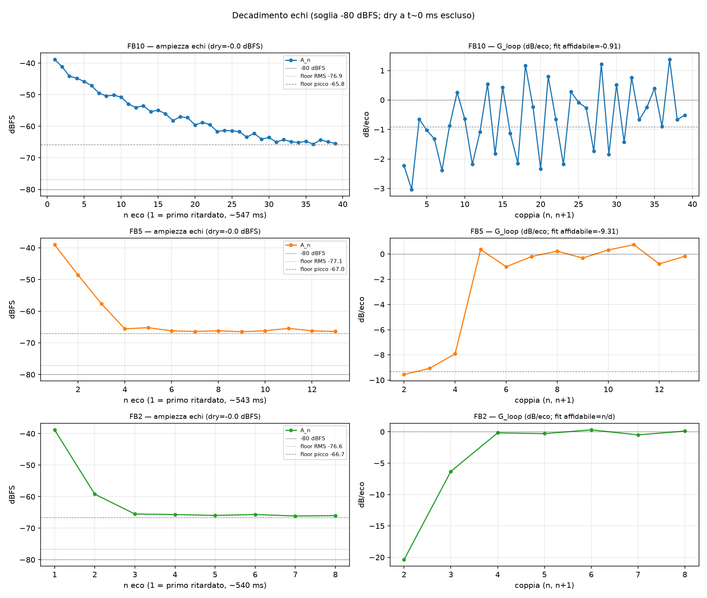
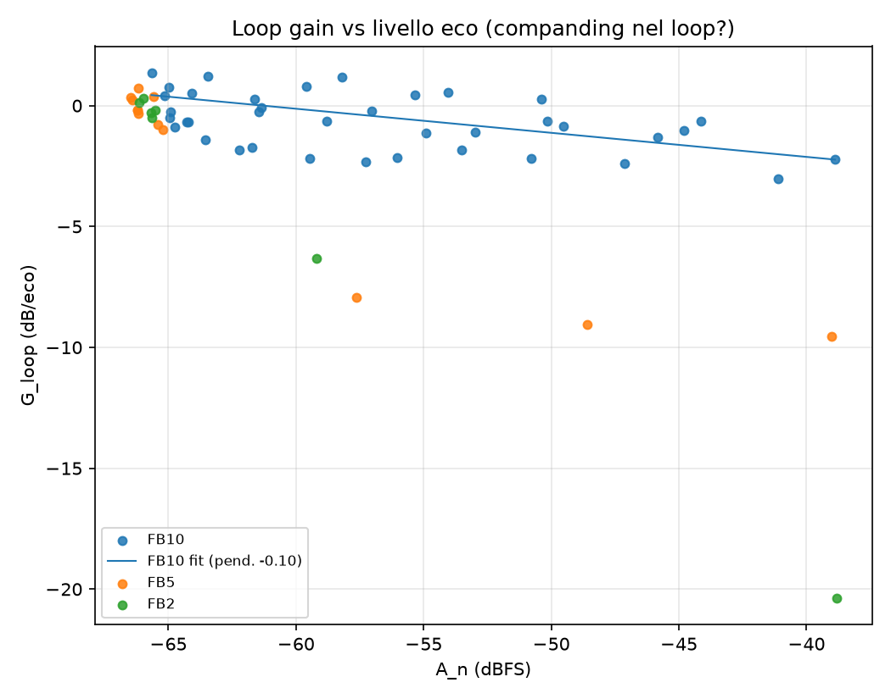
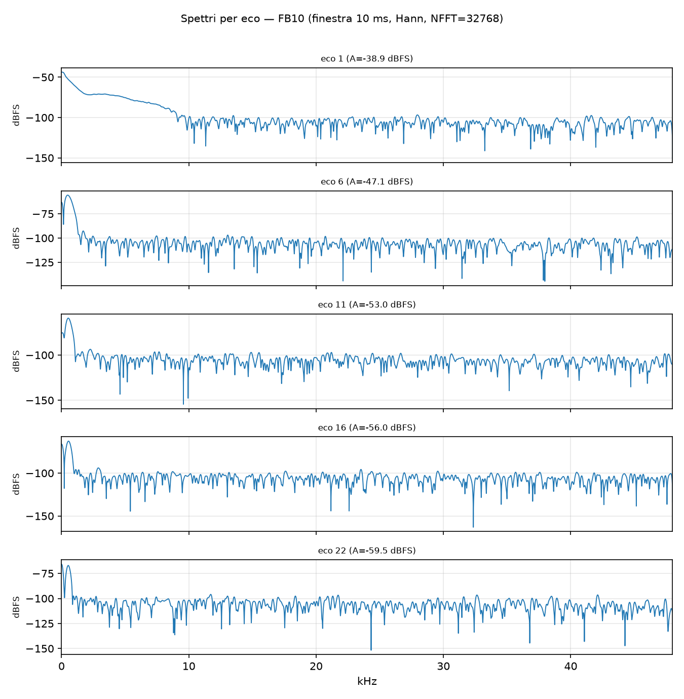
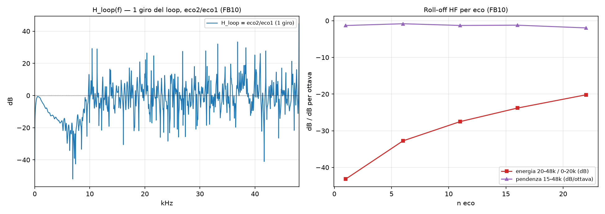
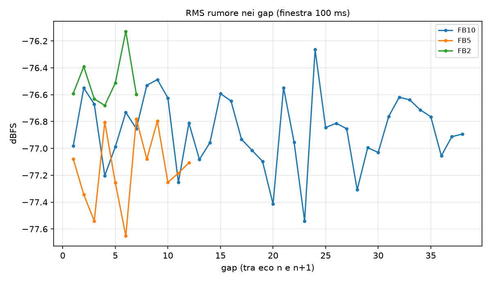
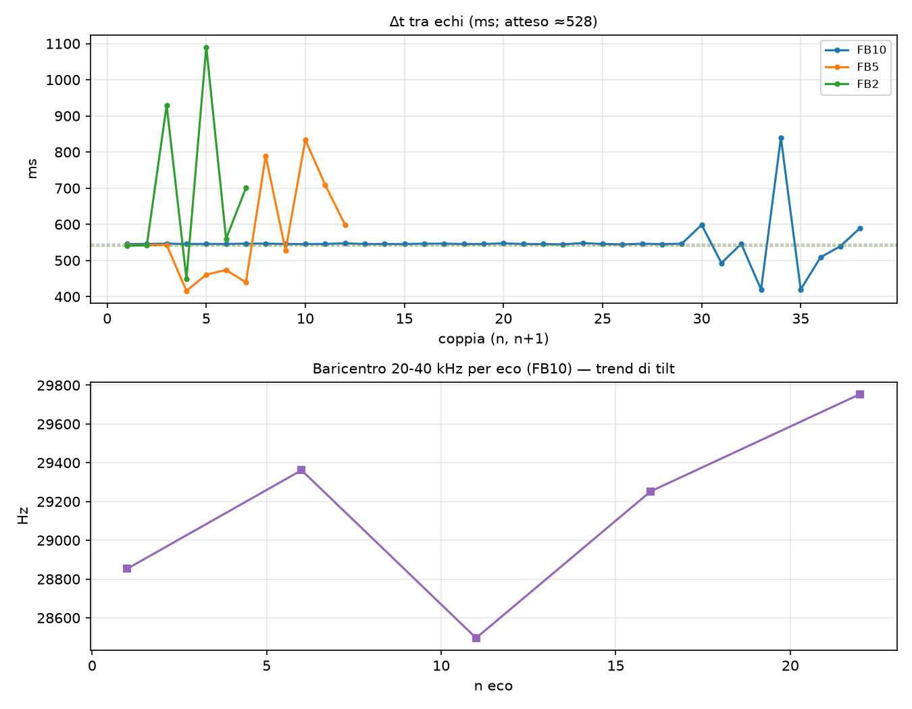

# Analisi misure feedback DDX-777 (FB 2 / 5 / 10)

Analisi delle tre registrazioni di feedback (impulso + catena di echi) per
caratterizzare il loop del riverbero/echo del DDX-777 e fornire i target per
la DSP del plugin.

**Nessuna modifica alla DSP**: questo report è solo analisi e raccomandazione.

---

## 1. Misure analizzate

| | FB10 | FB5 | FB2 |
|---|---|---|---|
| File | `peak 10, feedback 10, delay 10, 512 ms.wav` | `peak 10, feedback 5 circa, delay 10, 512 ms.wav` | `peak 10, feedback 2 circa, delay 10, 512 ms.wav` |
| Durata | ~21.3 s | ~7.4 s | ~5.4 s |
| Formato | 96 kHz, 24 bit, stereo (L≡R → uso L) | id. | id. |

- **Stimolo d'ingresso**: `01_impulse_single.wav` = delta monosample bianco
  (picco 1.0 al sample 0, solo 1 sample sopra −40 dB), 96 kHz float32.
- **Condizioni**: LEVEL = 10 (max), DELAY = 10, RANGE = 512 ms, HOLD = off,
  MODULATION = 0/off, FACTOR = x1.
- **Soglia di rilevamento echi**: −80 dBFS (direttiva utente).
- **Criterio di affidabilità**: un eco è "affidabile" se la sua ampiezza è
  sopra `(floor a picco del rumore) + 6 dB` (vedi §5).

---

## 2. Risultati principali

| Grandezza | FB10 | FB5 | FB2 |
|---|---|---|---|
| Echi rilevati (> −80 dBFS) | 39 | 13 | 8 |
| Echi **affidabili** | 22 | 3 | 2 |
| Dry (t≈0 ms) | 0.0 dBFS | 0.0 dBFS | 0.0 dBFS |
| Primo eco (t, A) | 547.1 ms, −38.9 dB | 543.7 ms, −39.0 dB | 540.7 ms, −38.8 dB |
| **G_forward** (input→eco1) | **−38.9 dB** | **−39.0 dB** | **−38.8 dB** |
| **G 1° giro** (eco1→eco2) | **−2.2 dB** | **−9.6 dB** | **−20.4 dB** |
| **Loop gain** (fit, regime affidabile) | **−0.91 dB/giro** | **−9.31 dB/giro** | n/d (2 echi) |
| Floor RMS nei gap | −76.9 dB | −77.1 dB | −76.6 dB |
| Floor a picco (max\|gap\|) | −65.8 dB | −67.0 dB | −66.7 dB |
| **Δt** mediana (affidabile) | **545.7 ± 0.6 ms** | 542.5 ± 0.4 ms | 541.5 ± 1.0 ms |
| Δt fit lineare (n) | 546.0 ms (n=22) | 542.4 ms (n=3) | n/d |
| Ampiezza ultimo eco | −65.5 dB | −66.4 dB | −66.0 dB |

> `G_forward` è l'attenuazione totale dell'impulso full-scale tra input e
> primo eco. `G 1° giro` è l'attenuazione tra il primo e il secondo eco
> (livello già −39 dB). La **loop gain (fit)** è la pendenza media nel regime
> affidabile (echi sopra il floor a picco) e determina la durata della coda.

---

## 3. Loop gain e companding nel loop

Il loop **non è un guadagno costante**: contiene un limitatore/compander
forte, dipendente dal livello.

- **G_forward ≈ −38.9 dB, identico per tutti e 3 i settaggi FB.** Il primo
  eco è sempre a −38.9 dB, indipendentemente dalla posizione del feedback:
  a livello full-scale è il limitatore (non il pot) a stabilire l'attenuazione.
- **G 1° giro e loop gain (coda) dipendono dal FB**:

  | FB | 1° giro (alto liv.) | Coda (basso liv., fit) | Echi affidabili |
  |---|---|---|---|
  | 10 (max) | −2.2 dB | −0.91 dB/giro | 22 |
  | 5 | −9.6 dB | −9.31 dB/giro | 3 |
  | 2 | −20.4 dB | ~−20 dB/giro (solo 1° giro) | 2 |

  Più feedback = meno attenuazione per giro = più echi, coda più lunga.
  Comportamento fisso coerente.

- **Modello**: `G_fb(livello) = G_pot + G_limitatore(livello)`
  - `G_pot` (basso livello): FB10 −0.91, FB5 −9.31, FB2 ~−20 dB/giro.
  - `G_limitatore`: ≈ 0 dB a basso livello, fino a ~−38 dB a full-scale
    (sopra una soglia ~−30/−40 dBFS, rapporto alto). È un **limitatore di
    picco** (l'impulso ha crest factor altissimo).

  Verifica: a full-scale `G_fb = G_pot + G_lim ≈ −0.91 − 38 ≈ −38.9 dB`
  (→ eco1 = −38.9 dB ✓). A livello −39 dB `G_lim ≈ −1.3 dB`, quindi
  `G_fb ≈ −2.2 dB` (→ eco2 = −41.1 dB ✓).

---

## 4. Periodo del loop (Δt)

- **Δt misurato ≈ 545.7 ms** (FB10, 22 echi affidabili, ±0.6 ms — molto
  stabile, jitter trascurabile).
- FB5 ≈ 542.4 ms (3 echi), FB2 ≈ 541.5 ms (2 echi): la piccola variazione è
  nell'incertezza (pochi echi affidabili). Il ritardo è **indipendente dal FB**,
  come atteso.
- **Scostamento dal nominale**: il filename indica "512 ms"; misurati
  **545.7 ms → +33.7 ms (+6.6%)**. Da indagare: il valore reale del pot
  "delay=10" potrebbe non essere 512 ms, oppure c'è un group delay aggiuntivo
  nel loop (filtri/D-A). **Raccomandazione**: usare il valore misurato
  (~545.7 ms) o verificare il mapping reale del pot delay.

---

## 5. Rumore nel loop (sampler)

- **Floor RMS nei gap ≈ −77 dB**, **identico per i 3 settaggi FB** → la
  quantizzazione (sampler) è **nel loop** e indipendente dal pot.
- **Floor a picco ≈ −66 dB** (crest factor ~11 dB sul RMS). I picchi del rumore
  raggiungono −66 dB.
- **Conseguenza**: gli echi sotto ~−60 dB si confondono con i picchi del
  rumore → **non affidabili**. La "coda" di echi a −65 dB (es. echi 31–39 di
  FB10) è in gran parte **rumore**, non echi reali: è per questo che il Δt e
  l'ampiezza diventano instabili in quella regione.
- Il floor stabile a −77 dB (RMS) è il **rumore di fondo del loop** (sampler
  12-bit / quantizzazione del feedback).

---

## 6. Analisi spettrale

- **Gli echi sono limitati di banda a 0–~15/20 kHz**: la banda 20–48 kHz è al
  floor (≈ −105 dBFS/bin) per **tutti** gli echi. Energia concentrata a bassa
  frequenza.
- **Bande FB10** (RMS in banda, dBFS):

  | n eco | e_0–20k | e_20–48k | ratio 20-48k/0-20k |
  |---|---|---|---|
  | 1 | −61.8 | −105.0 | −43.2 dB |
  | 6 | −72.8 | −105.5 | −32.8 dB |
  | 11 | −77.6 | −105.1 | −27.5 dB |
  | 16 | −81.1 | −104.9 | −23.8 dB |
  | 22 | −85.0 | −105.2 | −20.2 dB |

  L'energia 0–20k decade con l'eco; la 20–48k resta al floor (→ il rapporto
  aumenta solo perché il 0–20k affonda, non perché le HF crescono).

- **H_loop = eco2/eco1 (1 giro, FB10)** — medi per banda:
  100–1k: −1.1 dB · 1–5k: −12.4 dB · 5–10k: −18.3 dB · 10–20k: ~0 dB ·
  20–48k: al floor. Il giro attenua di più il medio (1–10 kHz) a livello alto;
  il shape è **dipendente dal livello** (a livello basso il giro diventa quasi
  trasparente) — coerente col compander.
- **Nota**: lo spettro del **dry** (a t≈0 ms) **non è misurabile** — essendo
  all'inizio del file, il windowing simmetrico è troncato e corrotto. Le
  affermazioni spettrale valgono per gli echi (interni al file).

---

## 7. Grafici

| | |
|---|---|
|  | Decadimento echi + G_loop per FB (dry separato, floor RMS/picco). |
|  | Loop gain vs livello (companding nel loop). |
|  | Spettri per eco (FB10): energia 0–15k, HF al floor. |
|  | H_loop = eco2/eco1 (1 giro) + roll-off per eco. |
|  | RMS rumore nei gap (floor ≈ −77 dB, costante). |
|  | Δt tra echi (stabile ≈545.7 ms) + baricentro 20–40k. |

---

## 8. Raccomandazioni per la DSP del plugin

Per emulare fedelmente il feedback del DDX-777:

1. **Guadagno del pot (loop gain a basso livello), per posizione**:
   - FB=10 → **−0.91 dB/giro** (≈ 0.901 lineare)
   - FB=5  → **−9.31 dB/giro** (≈ 0.342 lineare)
   - FB=2  → **~−20 dB/giro** (≈ 0.10 lineare, dal 1° giro; coda non osservabile)
   Mappare la posizione del pot feedback a questi guadagni per giro.

2. **Limitatore di picco nel loop** (la caratteristica dominante):
   - Soglia ~−30/−40 dBFS, rapporto alto (≥ 10:1).
   - A full-scale deve aggiungere **~−38 dB** di attenuazione oltre al guadagno
     del pot (così il 1° eco è a −38.9 dB per ogni FB).
   - A basso livello (sotto soglia) ≈ trasparente (0 dB).
   È ciò che rende il 1° eco molto più debole dell'input e la coda lenta.

3. **Low-pass nel loop**: cutoff **~15–20 kHz** per limitare la banda degli echi
   (nessuna energia utile oltre ~20 kHz) ed evitare accumulo HF/aliasing.

4. **Ritardo del loop**: usare **~545.7 ms** (misurato, FB10) oppure verificare
   il mapping reale del pot delay (nominale "512 ms" → scostato +6.6%).

5. **Jitter/wow**: il delay è molto stabile (Δt ±0.6 ms su 22 echi, FB10) →
   non serve modellare wow/jitter significativo.

---

## 9. Limiti e incertezze

- **HF (20–48 kHz) al floor**: il roll-off HF per giro e gli armonici/aliasing
  sopra ~15 kHz **non sono pienamente risolvibili** con queste misure (segnale
  sotto il rumore). Documentato come limite.
- **Coda degli echi (−65 dB)**: contaminata dal rumore a picco (−66 dB); gli
  "echi" 31–39 di FB10 (e i correspondenti di FB5/FB2) sono in gran parte
  rumore → scartati dall'analisi affidabile.
- **Δt +33.7 ms vs nominale 512 ms**: da confermare (mapping pot / group
  delay). Non risolvibile coi soli dati.
- **FB2**: solo 2 echi affidabili → loop gain a basso livello incerto.
- **Spettro del dry non misurabile** (windowing troncato all'inizio del file).

---

## 10. Riproduzione

```bat
cd /d <PROJECT_ROOT>\Plugin\tests
python feedback_analysis.py
```

Output (in `Plugin\tests\`): `feedback_results.json` + 6 PNG
(`feedback_decay`, `feedback_g_vs_level`, `feedback_spectra_per_echo`,
`feedback_loop_transfer`, `feedback_noise_vs_echo`, `feedback_jitter`).

Input (read-only): i 3 WAV in `Prep\Segnali_Test\Risultati\` +
`Prep\Segnali_Test\01_impulse_single.wav`.
