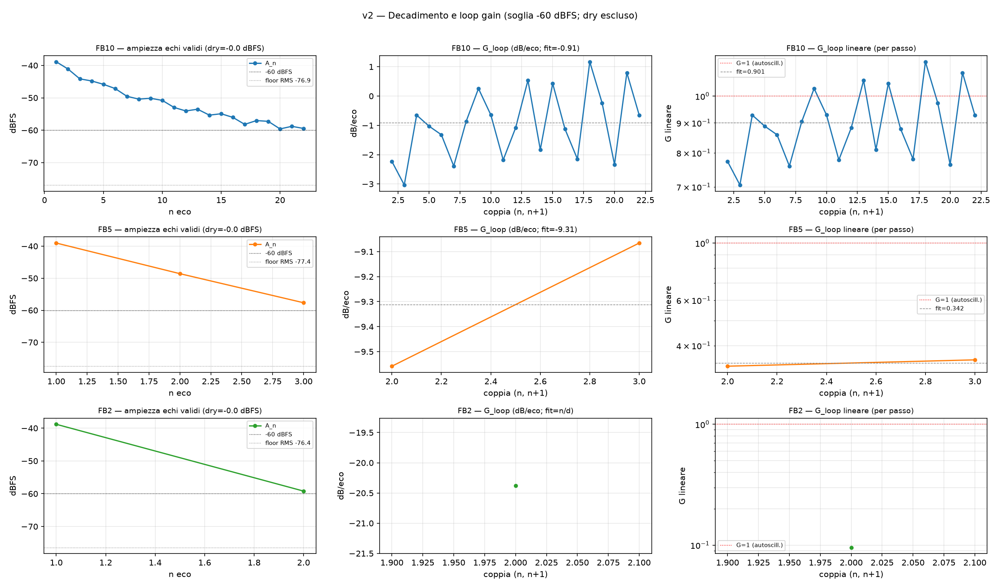
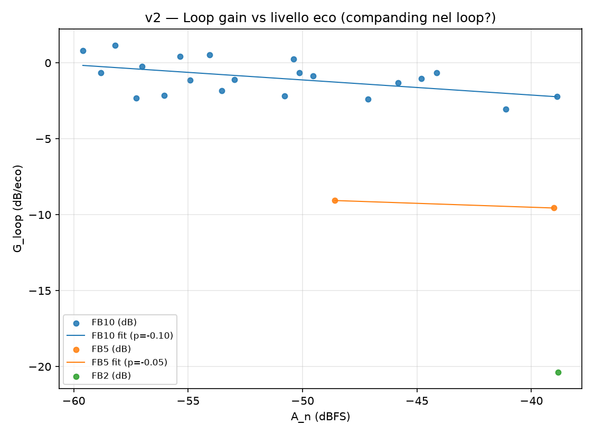
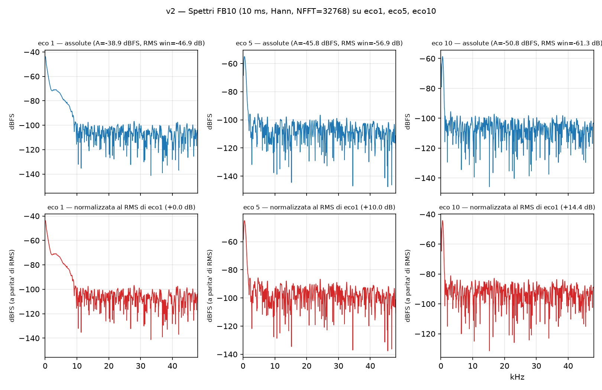
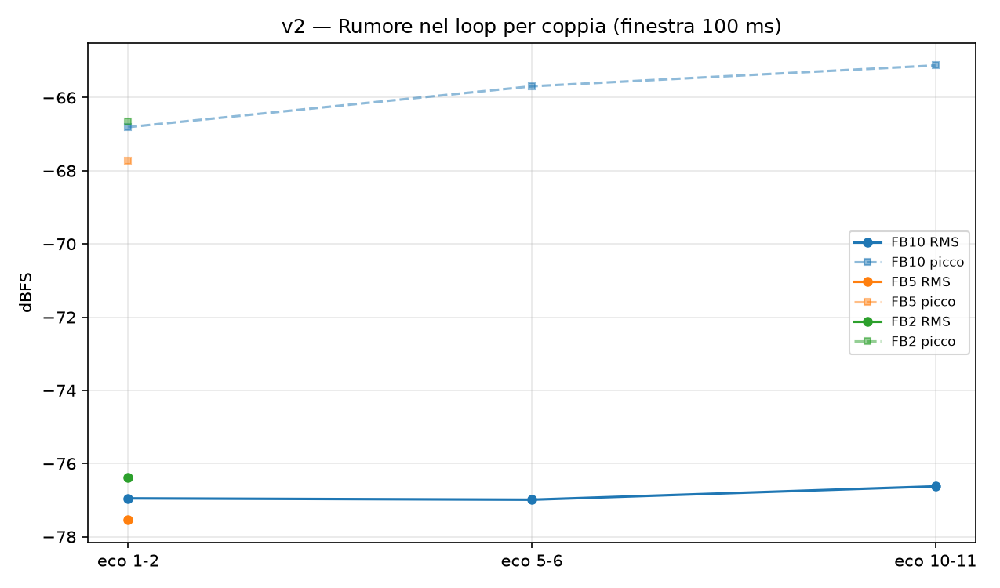
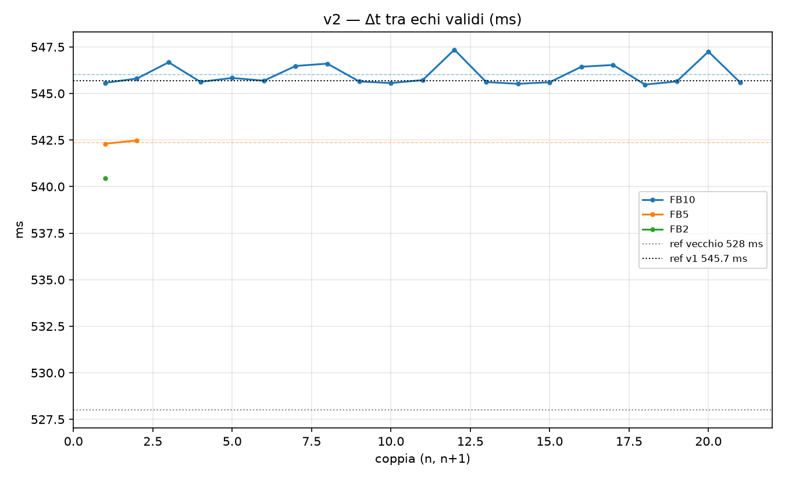

# Rianalisi misure feedback DDX-777 — soglia corretta −60 dBFS (v2)

Rianalisi delle tre registrazioni di feedback (impulso + catena di echi) con
una **soglia unica e fissa a −60 dBFS (peak)**, in sostituzione del metodo v1
(rilevamento a −80 dBFS + criterio di affidabilità adattivo
`floor a picco + 6 dB`). L'obiettivo è stabilire, senza ambiguità, quali echi
sono davvero sopra il rumore e fornire i target lineari per il modello DSP
(soglia di autoscillazione `G_lineare = 1`).

**Nessuna modifica alla DSP**: questo report è solo analisi e raccomandazione.
Il report v1 (`FEEDBACK_ANALYSIS.md`) resta intatto per confronto.

---

## 0. Metodo e soglia

- **Soglia unica: −60 dBFS a picco.** Un eco è rilevato e valido se il suo
  picco (massimo |campione| nella finestra ±3 ms attorno al candidato) è
  **> −60 dBFS**. I campioni/echi sotto −60 **non vengono contati**. Non c'è
  margine adattivo sul noise floor: la separazione è fissa.
- **Stima del noise floor**: finestre di 100 ms al centro di ogni gap tra echi
  contigui (come in v1); il floor è la mediana dei gap.
- **Dry escluso**: il picco a t<5 ms (~0 dBFS) è l'impulso d'ingresso
  (riferimento), non un eco.
- **Loop gain** riportata in entrambi i domini:
  - `G_dB[n] = A[n+1] − A[n]` (dB, differenza di ampiezza),
  - `G_lin[n] = A[n+1] / A[n]` (scala lineare, rapporto) — confronto diretto
    con la soglia di autoscillazione del modello (`G_lin = 1`).
- **Δt**: fit lineare `t = t0 + n·Δt` sugli echi validi + errore standard.
- **Rumore progressivo**: gap tra le coppie (1-2, 5-6, 10-11), usate in modo
  dinamico — se un eco non è valido la coppia è segnalata come non coperta.
- **Spettro**: echi 1/5/10 (FB10), finestra 10 ms, Hann, NFFT=32768; per
  ciascun eco è riportato l'RMS della finestra, per confrontare gli spettri
  a parità di livello.

| | FB10 | FB5 | FB2 |
|---|---|---|---|
| File | `peak 10, feedback 10, delay 10, 512 ms.wav` | `peak 10, feedback 5 circa, delay 10, 512 ms.wav` | `peak 10, feedback 2 circa, delay 10, 512 ms.wav` |
| Formato | 96 kHz, 24 bit, stereo (L≡R → uso L) | id. | id. |

Condizioni: LEVEL=10, DELAY=10 ("512 ms"), RANGE, HOLD=off, MODULATION=0,
FACTOR=x1. Stimolo: `01_impulse_single.wav` (delta monosample bianco).

---

## 1. Noise floor per file

Misurato come mediana delle finestre (100 ms) nei gap tra echi validi.

| Grandezza | FB10 | FB5 | FB2 |
|---|---|---|---|
| **Floor RMS** | **−76.9 dB** | −77.4 dB | −76.4 dB |
| **Floor a picco** (max\|gap\|) | **−66.0 dB** | −67.5 dB | −66.7 dB |
| Crest factor (picco−RMS) | ~10.9 dB | ~9.9 dB | ~9.7 dB |

- Identico (±0.5 dB) per i 3 settaggi FB → la quantizzazione (sampler 12-bit)
  è **nel loop** e indipendente dal pot, come in v1.
- La soglia −60 dBFS sta **~6 dB sopra** il floor a picco (−66 dB): separazione
  pulita segnale/rumore. Non esistono echi "a metà": un eco o è sopra −60 o si
  confonde col rumore.

---

## 2. Echi validi a −60 dBFS (vs conteggio precedente)

| | FB10 | FB5 | FB2 |
|---|---|---|---|
| **Echi validi a −60 (v2)** | **22** | **3** | **2** |
| Echi rilevati a −80 (v1) | 39 | 13 | 8 |
| Echi "affidabili" (v1, floor+6 dB) | 22 | 3 | 2 |
| **Extra scartati come rumore (v1 − v2)** | **17** | **10** | **6** |

- I conteggi validi v2 (22/3/2) coincidono con gli "affidabili" v1: la soglia
  fissa −60 dBFS formalizza esattamente il confine già individuato in v1.
- Gli **extra di v1** (39−22=17 su FB10; 13−3=10 su FB5; 8−2=6 su FB2) hanno
  ampiezze tra **−61.6 e −65.5 dB**, cioè **a o sotto il floor a picco (−66 dB)**:
  erano picchi di rumore, non echi. Con la soglia corretta vengono esclusi.
- **Massime ripetizioni udibili a −60 dBFS**: **FB10 → 22 echi**, **FB5 → 3**,
  **FB2 → 2**.

---

## 3. Loop gain G per FB (dB e scala lineare)

| Grandezza | FB10 | FB5 | FB2 |
|---|---|---|---|
| **G_forward** (dry→eco1, full scale) | **−38.9 dB** | −39.0 dB | −38.8 dB |
| **G 1° giro** (eco1→eco2, alto liv.) | **−2.23 dB / 0.7735 lin** | −9.56 dB / 0.3327 lin | −20.38 dB / 0.0957 lin |
| **G coda** (fit sugli echi validi) | **−0.91 dB / 0.9006 lin** (n=22) | −9.31 dB / 0.3423 lin (n=3) | n/d (n=2) |
| Pend. G-vs-livello (dB/dB) | −0.100 | −0.052 | n/d |

### Dipendenza dal livello (companding nel loop)

- **G_forward ≈ −38.9 dB, identico per i 3 FB**: a full-scale è il
  limitatore/compander (non il pot) a fissare l'attenuazione input→eco1.
- Il **1° giro attenua più della coda**: a FB10 da −2.23 dB (alto livello)
  a −0.91 dB (coda). `G-vs-livello` con pendenza negativa (−0.10 dB/dB a FB10):
  all'abbassare del livello il giro diventa meno attenuante (≈ trasparente).
  Coerente col limitatore/compander presente nel loop.
- **Tutti i G sono < 1 in scala lineare** (0.90 a FB10) → **decadimento**,
  nessuna autoscillazione sostenuta nemmeno a FB=10. La coda è lentamente
  smorzata, non plateau.

### G per eco (FB10, tutti i 22 validi)

| n | A (dBFS) | G_dB | G_lin | | n | A (dBFS) | G_dB | G_lin |
|---|---|---|---|---|---|---|---|---|
| 1 | −38.88 | — | — | | 12 | −54.06 | −1.09 | 0.8822 |
| 2 | −41.11 | −2.23 | 0.7735 | | 13 | −53.52 | +0.54 | 1.0638 |
| 3 | −44.15 | −3.03 | 0.7053 | | 14 | −55.35 | −1.83 | 0.8103 |
| 4 | −44.80 | −0.65 | 0.9279 | | 15 | −54.92 | +0.43 | 1.0507 |
| 5 | −45.82 | −1.03 | 0.8886 | | 16 | −56.05 | −1.13 | 0.8781 |
| 6 | −47.14 | −1.32 | 0.8590 | | 17 | −58.19 | −2.15 | 0.7809 |
| 7 | −49.53 | −2.39 | 0.7596 | | 18 | −57.03 | +1.17 | 1.1441 |
| 8 | −50.40 | −0.87 | 0.9047 | | 19 | −57.26 | −0.24 | 0.9729 |
| 9 | −50.14 | +0.26 | 1.0300 | | 20 | −59.60 | −2.34 | 0.7642 |
| 10 | −50.79 | −0.64 | 0.9285 | | 21 | −58.80 | +0.79 | 1.0958 |
| 11 | −52.97 | −2.18 | 0.7781 | | 22 | −59.46 | −0.65 | 0.9277 |

Il G per-coppia oscilla ±~1.5 dB attorno al fit (ampiezza di picco monosample);
il fit (−0.91 dB / 0.9006 lin) è il valore rappresentativo.

FB5 (n=3): eco1 −39.03 → eco2 −48.58 (G −9.56 dB / 0.3327) → eco3 −57.65
(G −9.07 dB / 0.3521).
FB2 (n=2): eco1 −38.82 → eco2 −59.20 (G −20.38 dB / 0.0957, singola coppia).

---

## 4. Periodo del loop (Δt): fit + incertezza

| Grandezza | FB10 | FB5 | FB2 |
|---|---|---|---|
| **Δt fit ± err. stand.** | **546.02 ± 0.01 ms** (n=22) | 542.39 ± 0.05 ms (n=3) | 540.46 ms (1 coppia) |
| Δt mediana ± SCD | 545.69 ± 0.57 ms | 542.39 ± 0.09 ms | 540.46 ms |
| **Δ vs 528 ms (vecchio, sess. 11)** | **+18.0 ms** | +14.4 ms | +12.5 ms |
| **Δ vs 545.7 ms (v1)** | **+0.3 ms** | −3.3 ms | −5.2 ms |
| Δ vs nominale 512 ms | +34.0 ms (+6.6%) | +30.4 ms | +28.5 ms |

- Il fit è stabile (±0.01 ms su 22 echi, FB10) → **jitter trascurabile**.
- **Δt è sostanzialmente identico a v1** (546.0 vs 545.7 ms, +0.3 ms) e
  **più alto del valore "vecchio" 528 ms di +18 ms**.
- **Scostamento dal nominale "512 ms"**: +34 ms (+6.6%), confermato.
- **Osservazione**: debole trend Δt crescente col FB (540.5 → 542.4 → 546.0 ms
  da FB2→FB10). Con n piccolo (2-3 echi su FB2/FB5) è compatibile con
  incertezza, ma potrebbe indicare un **group delay dipendente dal livello**
  nel loop (compander/limiter). Da tenere d'occhio, non risolvibile qui.

---

## 5. Rumore progressivo nel loop

Gap (100 ms) tra le coppie richieste, usato in modo dinamico sugli echi validi.

| Coppia | FB10 | FB5 | FB2 |
|---|---|---|---|
| eco 1-2 | −77.0 dB (RMS) | −77.5 dB (RMS) | −76.4 dB (RMS) |
| eco 5-6 | −77.0 dB (RMS) | non coperta (3 echi) | non coperta |
| eco 10-11 | −76.6 dB (RMS) | non coperta | non coperta |

- **Su FB10 (tutte le coppie coperte)** il rumore è **piatto**:
  −77.0 → −77.0 → −76.6 dB, Δ = +0.4 dB su 9 giri. **Nessun accumulo progressivo**
  del rumore nel loop.
- Il floor è stazionario: la quantizzazione del sampler è presente a ogni
  passata ma **non si somma oltre il floor** (il segnale resta sopra il rumore
  fino a −60 dB, poi scompare).
- FB5/FB2: solo la coppia 1-2 coperta (pochi echi validi), stesso livello
  (~−76/−77 dB) → coerente.

**Conseguenza per il modello**: il rumore in-loop va modellato come un **floor
fisso ≈ −77 dB RMS (picchi ≈ −66 dB)**, **senza accumulo progressivo**. Il
modello non deve far crescere il rumore col numero di ripetizioni; deve solo
aggiungere il floor a ogni giro.

---

## 6. Spettro degli echi validi (FB10, eco 1/5/10)

Finestra 10 ms, Hann, NFFT=32768. L'RMS della finestra è riportato per
normalizzare i confronti a parità di livello.

| Grandezza | eco 1 | eco 5 | eco 10 |
|---|---|---|---|
| A (picco) | −38.9 dBFS | −45.8 dBFS | −50.8 dBFS |
| **RMS finestra (10 ms)** | **−46.9 dB** | −56.9 dB | −61.3 dB |
| **Normalizzazione RMS (eco1→x)** | 0 dB | −10.0 dB | **−14.4 dB** |
| Energia 0–20 kHz | −61.8 dB | −71.6 dB | −76.4 dB |
| Energia 20–48 kHz | −105.0 dB | −106.0 dB | −105.7 dB |
| Ratio 20-48k / 0-20k | −43.2 dB | −34.4 dB | −29.3 dB |
| Pendenza 15–47 kHz | −1.3 dB/ott | −2.2 dB/ott | −1.2 dB/ott |

- **La banda 20–48 kHz è al floor (≈ −105 dB) per tutti gli echi**, mentre la
  0–20 kHz decade con l'eco (−61.8 → −76.4 dB). Il "ratio HF" che aumenta
  (−43 → −29 dB) è solo perché il 0-20k affonda, **non** perché le HF crescono.
- **Gli echi sono limitati di banda a ~15/20 kHz**; sopra non c'è segnale
  utile, solo rumore.
- **A parità di livello (normalizzato all'RMS di eco1)** le curve spettrali
  hanno la stessa forma: leggero roll-off oltre ~10-15 kHz, nessun picco
  armonico/aliasing sopra il floor. Il shape spettrale **non cambia** con il
  numero di giro (dentro la risoluzione).
- **Nota di normalizzazione**: eco10 è −14.4 dB sotto eco1 in RMS (−11.9 dB in
  picco). I confronti spettrali vanno quindi fatti sulla versione normalizzata,
  non sul valore assoluto.

---

## 7. Raccomandazioni per la DSP del modello

Per emulare fedelmente il feedback del DDX-777 (target da queste misure, soglia
−60 dBFS):

1. **Guadagno di loop a basso livello (scala lineare), per posizione pot**:
   - FB=10 → **0.9006** (−0.91 dB/giro, n=22)
   - FB=5  → **0.3423** (−9.31 dB/giro, n=3)
   - FB=2  → **~0.096** (−20.4 dB/giro, dal solo 1° giro; coda non osservabile)
   Riferimento per `loopGainFor()` in `DDX777Core.h` (tabella × G_catena ≈ 1.07 a
   1 kHz): a 100% il modello dà ~0.88 (vs 0.90 misurato, **match**); a 50% ~0.48
   e a 25% ~0.24, **più alti** del misurato (0.34 / 0.10). Se il mapping del pot
   "circa" (≈50% / ≈25%) è confermato, il taper 25-50% andrebbe ricalibrato
   verso il basso.

2. **Massime ripetizioni udibili a −60 dBFS** (target lunghezza coda):
   **FB10 → 22**, **FB5 → 3**, **FB2 → 2**.

3. **Loop gain dipendente dal livello** (compander/limiter nel loop):
   - `G_forward ≈ −38.9 dB` a full-scale, **identico per tutti i FB** → la catena
     di saturazione d'ingresso + compressore del modello deve produrre ~−39 dB da
     dry→eco1 a full-scale (da verificare in `verify.py`).
   - Il 1° giro attenua di più (−2.2 dB a FB10) della coda (−0.9 dB): il modello
     deve restituire un `G` che cresce verso 1 al diminuire del livello.

4. **Rumore in-loop**: **floor fisso ≈ −77 dB RMS (picchi ≈ −66 dB)**,
   **senza accumulo progressivo** (§5). Il `kHissRms = 1.8e-4` (≈ −77.3 dBFS)
   attuale è già coerente; non serve far crescere il rumore col numero di giri.
   Gli echi sotto −60 dB non sono udibili → il modello può fermare le
   ripetizioni a −60 dBFS.

5. **Ritardo del loop**: usare **~546 ms** (misurato, FB10, n=22) oppure
   verificare il mapping reale del pot delay (nominale "512 ms" → scostato
   +6.6%; e +18 ms vs il valore "vecchio" 528 ms).

6. **Banda del loop**: confermato **low-pass ~15-20 kHz** (§6): nessuna energia
   utile oltre ~20 kHz, nessuna accumulo HF/aliasing. La catena virtual-ADC
   32 kHz del modello (8° ordine @15 kHz) è coerente; nessuna modifica
   necessaria.

7. **Wow/jitter**: trascurabile (Δt ±0.6 ms su 22 echi, FB10) → non serve
   modellare wow/jitter significativo.

---

## 8. Limiti e incertezze

- **FB2 (n=2) e FB5 (n=3)**: G e Δt su 1-2 coppie → bassa confidenza (sopr. FB2).
- **Δt vs nominale 512 ms (+34 ms) e vs 528 ms (+18 ms)**: non risolvibile con i
  soli dati (mapping del pot delay / group delay aggiuntivo). Documentato come
  da verificare.
- **Trend Δt FB2→FB10 (540.5→546.0 ms)**: n piccolo; compatibile con
  incertezza, ma possibile group delay dipendente dal livello.
- **20-48 kHz al floor**: roll-off HF per giro e armonici/aliasing sopra
  ~15-20 kHz **non pienamente risolvibili** (segnale sotto il rumore).
- **G per-coppia ±~1.5 dB**: la G istantanea è rumorosa (picco monosample); il
  fit è il valore affidabile.
- **Spettro del dry non misurabile** (windowing troncato all'inizio del file);
  le affermazioni spettrali valgono per gli echi (interni al file).

---

## 9. Grafici (v2)

| | |
|---|---|
|  | Decadimento echi validi (soglia −60) + G_loop in dB e **lineare** per FB. |
|  | Loop gain vs livello (companding nel loop). |
|  | Spettri FB10 eco 1/5/10: assolute + **normalizzate a parità di RMS**. |
|  | Rumore nel loop per coppia (1-2 / 5-6 / 10-11), pianificato. |
|  | Δt tra echi validi (fit ≈546 ms) vs ref 528/545.7 ms. |

---

## 10. Riproduzione

```bat
cd /d <PROJECT_ROOT>\Plugin\tests
python feedback_analysis_v2.py
```

Output (in `Plugin\tests\`): `feedback_results_v2.json` + 5 PNG
(`feedback_v2_decay`, `feedback_v2_g_vs_level`, `feedback_v2_spectra`,
`feedback_v2_noise_progressive`, `feedback_v2_deltat`).

Input (read-only): i 3 WAV in `Prep\Segnali_Test\Risultati\` +
`Prep\Segnali_Test\01_impulse_single.wav`.

**Differenze da v1**: soglia fissa −60 dBFS (vs −80 + floor+6 dB); loop gain
anche in scala lineare; rumore progressivo a coppie dinamiche; spettri
normalizzati all'RMS per eco; Δt con errore standard del fit.
